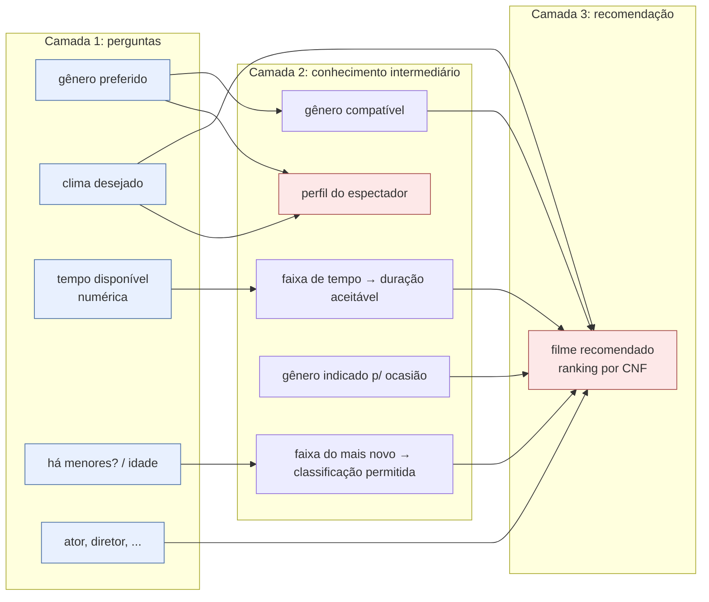

# Trabalho 3: Sistemas Especialistas no Expert SINTA

**Disciplina:** Fundamentos de Sistemas Inteligentes (UTFPR, Câmpus Santa Helena)
**Docente:** Thiago Naves
**Entregáveis principais:** `saida/Famosos.bcm` e `saida/Filmes.bcm` (formato do Expert SINTA 1.1b)

**Revisão:** 28/11/2026. Estatísticas, testes e figuras referem-se às bases finais, executadas no **ExSINTA real**. Pesquisa e critérios: [FONTES.md](../dados/FONTES.md), com referências por item em [fontes.csv](../dados/fontes.csv).

---

## Sumário

1. [Resumo](#1-resumo)
2. [O que foi pedido e como foi atendido](#2-o-que-foi-pedido-e-como-foi-atendido)
3. [A ferramenta: Expert SINTA](#3-a-ferramenta-expert-sinta)
4. [Abordagem: engenharia do conhecimento orientada a dados](#4-abordagem-engenharia-do-conhecimento-orientada-a-dados)
5. [Sistema 1: "Quem é o Famoso?"](#5-sistema-1-quem-é-o-famoso)
6. [Sistema 2: "Que Filme Eu Vejo?"](#6-sistema-2-que-filme-eu-vejo)
7. [Validação e testes](#7-validação-e-testes)
8. [Limitações e observações](#8-limitações-e-observações)
9. [Como usar e como regenerar](#9-como-usar-e-como-regenerar)
10. [Estrutura dos arquivos](#10-estrutura-dos-arquivos)

Apêndices, gerados automaticamente a partir das bases:
[apendice_famosos.md](apendice_famosos.md) e [apendice_filmes.md](apendice_filmes.md).

---

## 1. Resumo

Foram construídos **dois sistemas especialistas** no shell **Expert SINTA**:

| | Sistema 1: **Quem é o Famoso?** | Sistema 2: **Que Filme Eu Vejo?** |
|---|---|---|
| Recomenda | pessoas famosas (atores, cantores, atletas, apresentadores e personagens fictícios) | filmes nacionais e internacionais |
| Com base em | características físicas, área de trabalho, época, origem, traços marcantes e **obras** | gênero, clima/sensação, **duração**, idade do espectador, época, origem, fatos reais, prêmios, sagas, **atores** e **diretores** |
| Base de dados | **97 famosos** (48 brasileiros), 21 atributos | **145 filmes** (38 brasileiros, 1936–2025), 13 atributos + 2 derivados |
| Regras | **827** | **2.374** |
| Premissas / conclusões | 3.571 / 900 | 17.551 / 2.481 |
| Variáveis / perguntas / objetivos | 33 / 22 / 9 | 28 / 16 / 9 |

**Total: 3.201 regras** nos dois sistemas, geradas no formato do Expert SINTA e todas **alcançáveis no simulador**, conforme demonstrado na seção 7.

Diferenciais (o enunciado valoriza "novas abordagens de conhecimento, base de dados e algoritmos"):

- **Engenharia reversa do formato `.BCM`** a partir do código-fonte do SINTA e um **gerador** que compila dados (CSV) + configuração (YAML) diretamente em bases do SINTA. As bases são grandes, consistentes e reprodutíveis.
- **Arquitetura de conhecimento em 3 camadas**, com uma **camada de compatibilidade** gerada automaticamente: trata "indiferente", resposta em branco e agrupamentos como "estrangeira" ou "recentes".
- **Ranking por acúmulo de evidências** usando a combinação de fatores de confiança do próprio SINTA (`ca + cn − ca·cn`, um *noisy-OR*).
- **Lógica difusa** em faixas numéricas (altura → estatura; tempo → duração) e **comparações numéricas exatas** por item (`tempo disponível >= 148`).
- **Simulador** da máquina de inferência do SINTA (port do código Pascal), com resultados idênticos aos do ExSINTA real, usado em milhares de consultas de teste.
- **Driver da interface do ExSINTA** em Python, portátil (Windows, ou Linux/macOS pelo Wine): executa consultas completas sem intervenção, confere cada pergunta e captura os resultados. As **oito consultas de referência e a regravação das bases finais foram feitas no ExSINTA real**, além de 881 testes de regressão de duração e direção.

## 2. O que foi pedido e como foi atendido

| Requisito do enunciado | Como foi atendido |
|---|---|
| Dois sistemas especialistas no Expert SINTA | `saida/Famosos.bcm` e `saida/Filmes.bcm`, abertas e regravadas pelo ExSINTA real com semântica idêntica (827 e 2.374 regras) |
| SE 1: famosos por **características físicas** e **obras** | sexo, faixa etária, cor do cabelo, cor dos olhos, **altura (cm)**, espécie (personagens), traços marcantes; obras em 5 categorias (filmes/séries/novelas, músicas, times/competições, franquias, programas) |
| Atores, cantores, personagens fictícios e outras celebridades | 26 atores, 27 cantores, 14 atletas, 23 personagens e 7 apresentadores/influenciadores (categoria principal) |
| SE 2: filmes por **estilo, duração, gênero, atores, ano** e outras informações | clima/estilo, duração exata × tempo disponível, 14 gêneros, 255 regras de ator, ano → época, além de diretor, país/origem, fatos reais, prêmios, sagas, classificação indicativa e ocasião |
| Filmes nacionais e internacionais | 38 brasileiros e 107 internacionais de 12 países (séries e novelas **não** incluídas, por decisão do grupo) |
| Base de dados o mais completa possível, com pesquisa | 97 famosos × 21 atributos; 145 filmes × 15 atributos; pesquisa documental por amostragem, fontes por item/campo, vocabulário e validação estrutural (seção 7.1) |
| Máximo de regras possível | 3.201 regras, geradas sistematicamente (5 a 12 regras por famoso e 12 a 20 por filme) |
| Estabelecer todos os objetivos e variáveis | 9 objetivos por base (ordem de perguntas + objetivos visíveis), 61 variáveis, 38 perguntas, todas com texto de **"Por quê?"** |
| Executar de forma funcional pelo Expert SINTA | 8 consultas completas no ExSINTA real com as bases finais, iguais ao simulador (seção 7.3) |

## 3. A ferramenta: Expert SINTA

O Expert SINTA (LIA/UFC) é um *shell* de sistemas especialistas baseado em **regras de produção** e **encadeamento para trás** (*backward chaining*). Conceitos usados no trabalho:

- **Regra:** `SE <premissas ligadas por E/OU> ENTÃO <conclusões> CNF x%`.
- **Variáveis:** univaloradas, multivaloradas (acumulam vários valores, ideais para "recomendações"), numéricas e lógicas (Sim/Não). O valor especial **DESCONHECIDO** é atribuído quando o usuário não responde ou quando nenhuma regra conclui a variável.
- **Objetivos:** variáveis que o motor tenta descobrir, na ordem definida. Objetivos com "mostrar resultados" desligado simulam **encadeamento para frente** e servem para fixar a ordem das perguntas (técnica descrita no manual).
- **Fatores de confiança (CNF):** E → `c1·c2`; OU → `c1 + c2 − c1·c2`; conclusão → `CNF(premissas) × CNF(regra)`; o mesmo valor concluído duas vezes → `ca + cn − ca·cn`. Uma regra é aceita se o CNF das premissas for **≥ 50%**.

## 4. Abordagem: engenharia do conhecimento orientada a dados

### 4.1 Por que gerar as bases em vez de digitá-las

Cadastrar mais de 3.000 regras à mão na interface do SINTA seria lento e muito sujeito a erros, e qualquer correção nos dados exigiria refazer regras uma a uma. Como o código-fonte do SINTA acompanha o material (`sinta/SINTA/sintascr`), fizemos a **engenharia reversa** do formato binário `.BCM` (`EXSYSTEM.PAS`, rotinas `SaveToFile`/`LoadFromFile`) e escrevemos um **compilador de bases**:

```
dados/famosos.csv  ─┐                         ┌─> saida/Famosos.bcm  (abre no SINTA)
dados/famosos.yaml ─┼─> gerador/build.py ─────┼─> saida/Famosos.txt  (base legível)
dados/esquema_*.yaml┘   (DSL + modelos)       └─> saida/Famosos.json (estatísticas)
```

- **CSV:** os atributos de cada item (um famoso ou filme por linha); referências dos campos pesquisados em `dados/fontes.csv`.
- **Esquema (YAML):** o vocabulário controlado de cada atributo (ex.: os 14 gêneros).
- **Configuração (YAML):** variáveis, perguntas, "por quê", regras intermediárias (numa pequena linguagem `a = x OU a = y E b >= 10`), **modelos de regra** e **evidências**, aplicados a cada item.

O formato está documentado em [`docs/formato_bcm.md`](../docs/formato_bcm.md): strings Pascal de 256 bytes, inteiros de 16 bits e números `real` de 6 bytes (Real48). Um detalhe não óbvio: o conectivo gravado em cada premissa liga-a **à próxima**, e a última recebe "ENTÃO".

### 4.2 Arquitetura em camadas



**Camada 1: perguntas.** São as variáveis "X preferido". Quase todas são multivaloradas e têm a opção "indiferente".

**Camada 2: conhecimento intermediário**, de dois tipos:

- **Compatibilidade (gerada automaticamente).** Cada pergunta "X preferido" gera uma variável "X compatível":
  - `SE X preferido = v ENTÃO X compatível = v` (uma regra por valor);
  - `SE X preferido = indiferente ENTÃO X compatível = todos os valores`;
  - `SE X preferido = DESCONHECIDO ENTÃO X compatível = todos` (o usuário não marcou nada);
  - **grupos:** `SE origem preferida = estrangeira (qualquer país) ENTÃO origem compatível = norte-americana, britânica, …`; o mesmo vale para "clássicos (até os anos 90)", "recentes (de 2010 em diante)" e "pessoa real (qualquer área)".

  Assim, as regras dos itens ficam simples e robustas.
- **Regras escritas à mão:**
  - **altura (cm) → faixa → estatura difusa**, por exemplo 161–170 cm = 80% "baixa" e 70% "média";
  - **idade do mais novo → faixa → classificações permitidas**;
  - **tempo → faixa → durações aceitáveis**;
  - **companhia → gêneros indicados para a ocasião**, por exemplo casal → romance 100%, comédia 80%;
  - **20 regras de perfil do espectador**, como "Caçador(a) de adrenalina", "Coração mole" e "Fã do cinema nacional".

**Camada 3: recomendação.** Cada item recebe várias regras, geradas por **modelos** (combinações de atributos com CNFs diferentes) e por **evidências** (uma regra por ator, obra, traço, gênero em comum…).

### 4.3 Ranking por acúmulo de evidências (noisy-OR)

O objetivo é **multivalorado**, então o SINTA avalia todas as regras e, quando duas regras concluem o mesmo item, **combina** os graus de confiança com `ca + cn − ca·cn`. Cada regra funciona como uma evidência independente, e o resultado final é `1 − Π(1 − cᵢ)`.

Exemplo real (Sistema 1, usuário descrevendo o Wagner Moura):

| Regra disparada | CNF da regra | Acumulado |
|---|---|---|
| Wagner Moura - perfil completo | 90% | 90,000% |
| Wagner Moura - cabelo e olhos | 45% | 94,500% |
| Wagner Moura - idade e época | 35% | 96,425% |
| Wagner Moura - origem | 30% | 97,497% |
| Wagner Moura - área (atuação) | 55% | 98,874% |
| Wagner Moura - obra: Tropa de Elite | 85% | **99,831%** ← valor exibido pelo SINTA |

O SINTA ordena os resultados pelo CNF, o que produz um **ranking**: quem combina com mais evidências fica no topo, e itens parcialmente compatíveis aparecem abaixo com confiança menor.

### 4.4 Regras em forma normal conjuntiva

A opção de precedência dos conectivos do SINTA foi configurada como **OU** (`prioridade = OU`), de modo que `a1 OU a2 E b1 OU b2 E c` é avaliado como `(a1 ∨ a2) ∧ (b1 ∨ b2) ∧ c`. Cada atributo vira uma **cláusula** com as alternativas do item. Por exemplo, um filme de ação **ou** ficção científica, **e** de clima tenso **ou** reflexivo:

```text
Regra 1561  A Origem - perfil completo
SE    gênero compatível = ficção científica
OU    gênero compatível = ação
OU    gênero compatível = suspense
E     clima compatível = tenso
OU    clima compatível = reflexivo
E     época compatível = anos 2010
E     origem compatível = internacional
E     tipo de história compatível = ficção
E     tem limite de tempo = Não
OU    tem limite de tempo = DESCONHECIDO
OU    tempo disponível >= 148
OU    faixa de tempo = DESCONHECIDO
E     classificação permitida = 14
ENTÃO filme recomendado = A Origem CNF 90%
```

### 4.5 Técnicas adicionais

| Técnica | Para quê |
|---|---|
| **Objetivos ocultos** na ordem desejada | fixam uma ordem natural para as perguntas principais (encadeamento para frente simulado) |
| **Perguntas-porteira** (`quer citar uma obra?`, `quer escolher ator?`, `há menores?`) | perguntas condicionais. Graças ao curto-circuito do SINTA, a lista de atores só é exibida se o usuário quiser |
| **Perguntas dependentes da categoria** | "estilo musical" só aparece se a busca inclui cantores; "espécie" e "mídia", só se inclui personagens |
| **Número → faixa categórica → conclusão** | trata campos numéricos deixados em branco: a faixa vira DESCONHECIDO e há uma regra de fallback para isso (idade em branco → só filmes livres, por segurança) |
| **Comparação numérica por item** (`tempo disponível >= {duração}`) | todas as regras que recomendam filmes verificam o limite, inclusive ator, diretor, prêmios e ocasião |
| **Filtro de segurança** | toda regra de filme exige `classificação permitida = <classificação do filme>` |
| **Toda regra termina com premissa simples** | evita uma falha latente do SINTA (estouro de índice quando a última premissa está num grupo OU e o usuário responde com CNF fracionário), encontrada lendo o código do motor |

## 5. Sistema 1: "Quem é o Famoso?"

### 5.1 Base de dados (`dados/famosos.csv`)

97 famosos, pela categoria principal: 27 cantores, 26 atores, 23 personagens fictícios, 14 atletas e 7 apresentadores/influenciadores. Alguns acumulam categorias, como Will Smith (ator e cantor), Xuxa (cantora e apresentadora) e Seu Jorge (cantor e ator). Contando os acúmulos, 28 atuam e 29 cantam.

| Atributo | Valores |
|---|---|
| categoria | ator/atriz, cantor(a), atleta, personagem fictício, apresentador(a)/influenciador(a) |
| sexo | masculino, feminino |
| espécie | humano, animal, criatura/monstro, brinquedo/boneco |
| origem | brasileira, norte-americana, latino-americana/caribenha, britânica, outra europeia, asiática/oceania |
| faixa etária | criança/adolescente, jovem (até 30), adulto (31 a 50), maduro (51 ou mais) |
| cabelo | preto, castanho, loiro, ruivo, grisalho/branco, careca/raspado, colorido |
| olhos | escuros, azuis, verdes |
| estatura | baixa (até 1,65 m), média, alta (acima de 1,80 m) |
| traços | barba, bigode, tatuagens, óculos, cicatriz, cabelo cacheado/crespo, chapéu/boné, roupa/fantasia icônica, maquiagem marcante |
| época de sucesso | até anos 80, anos 90, anos 2000, anos 2010, anos 2020 |
| área | gênero de atuação (8), gênero musical (13), esporte (9), mídia (7), formato (4) |
| obras (distintas) | filmes/séries/novelas (69), músicas/álbuns/bandas (80), times/competições (29), franquias/universos (19), programas/canais (12) |

Decisões de qualidade dos dados:

- **Não classificamos o tom de pele de pessoas reais.** É um atributo sensível e fácil de errar. O traço físico "não humano" é tratado pelo atributo **espécie**.
- **Campos ausentes ficam em branco** (olhos: 70% preenchidos; estatura: 71%). O gerador **pula a condição** para esse item. Os campos físicos são descritores aproximados; sua existência não implica conferência documental individual (ver critérios em FONTES.md).
- Todos os 97 famosos têm **assinatura única** no conjunto de atributos.

### 5.2 Perguntas, na ordem em que aparecem

1. Que tipo de famoso você procura? *(categoria)*
2. É homem ou mulher?
3. Qual a faixa etária?
4. Como é o cabelo?
5. Qual a cor dos olhos?
6. Você sabe a altura aproximada? → **Qual a altura em centímetros?** *(numérica, 40–230)*
7. De onde é o famoso? *(inclui o grupo "estrangeira")*
8. Em que época fez mais sucesso? *(inclui os grupos "clássica" e "recente")*
9. Perguntas condicionais: espécie, gênero de atuação, estilo musical, esporte, mídia, formato, traços marcantes, "lembra de alguma obra?" e a lista de obras da categoria.

### 5.3 Regras (827)

| Tipo | Regras | CNF |
|---|---|---|
| Compatibilidade (gerada) | 56 | 100% |
| Altura → faixa → estatura (difusa) | 13 | 70–100% |
| Modelo **perfil completo** (todos os atributos) | 97 | 90% |
| Modelo **cabelo e olhos** | 66 | 45% |
| Modelo **idade e época** | 97 | 35% |
| Modelo **origem** | 97 | 30% |
| Modelos **área** (atuação, música, esporte, mídia, apresentação) | 102 | 55% |
| Evidências **obra** (5 categorias) | 231 | 85% |
| Evidências **traço marcante** | 68 | 30% |

### 5.4 Exemplo de consulta no ExSINTA

Usuário descrevendo: ator, masculino, adulto, cabelo castanho, olhos escuros, 174 cm, brasileiro, anos 2000 e 2010, ação/aventura, obra "Tropa de Elite".

O ExSINTA recomenda Wagner Moura (99,831%), Paulo Gustavo (97,497%), Rodrigo Santoro (82,675%), Johnny Depp e Pedro Pascal (75,25%), Selton Mello (61,5%) e, abaixo, outros atores com evidências parciais. A aba **Histórico** mostra a explicação do raciocínio (árvore de pesquisa do encadeamento para trás).

## 6. Sistema 2: "Que Filme Eu Vejo?"

### 6.1 Base de dados (`dados/filmes.csv`)

145 filmes: 38 brasileiros e 107 internacionais, de EUA, Reino Unido, França, Itália, Alemanha, Japão, Coreia do Sul, Argentina, México, Nova Zelândia e Austrália. Vão de *Tempos Modernos* (1936) a *O Agente Secreto* e *Pecadores* (2025).

| Atributo | Valores |
|---|---|
| ano → **época** (derivada) | clássico (até 1979), anos 80, 90, 2000, 2010, 2020 |
| duração (min) → **faixa** (derivada) | curta (até 100), média (101–130), longa (131–160), muito longa |
| gêneros (lista) | ação, aventura, animação, comédia, drama, crime, terror, suspense, ficção científica, fantasia, romance, musical, guerra, biografia |
| clima (lista) | divertido, emocionante, tenso, assustador, reflexivo, romântico, inspirador, épico |
| classificação indicativa | L, 10, 12, 14, 16, 18 |
| país / origem | 12 países / nacional, internacional |
| diretor, atores | 116 diretores, 191 atores (1 a 4 por filme) |
| prêmios | Oscar de Melhor Filme, Oscar de Filme Internacional, Oscar (outras), indicado ao Oscar, Palma de Ouro, prêmio em Cannes, Urso de Ouro, Leão de Ouro, Globo de Ouro |
| fatos reais, franquia | sim/não (22 baseados em fatos reais); 44 franquias (Star Wars, Harry Potter, Marvel, Tropa de Elite…) |

### 6.2 Perguntas

Há menores assistindo? → idade do mais novo *(numérica)*; gêneros; sensação/clima; tem limite de tempo? → tempo disponível *(numérica)*; nacional ou internacional; época *(com grupos)*; fatos reais ou ficção; com quem vai assistir; premiados?; sagas ou filmes únicos?; quer indicar atores? → lista; quer indicar diretores? → lista.

### 6.3 Dois objetivos visíveis

1. **Perfil do espectador**, uma inferência intermediária mostrada ao usuário. Exemplo de regra:

   ```text
   Regra 75  perfil: adrenalina (ação)
   SE    gênero preferido = ação
   OU    gênero preferido = suspense
   OU    gênero preferido = crime
   E     clima desejado = tenso
   ENTÃO perfil do espectador = Caçador(a) de adrenalina CNF 100%
   ```

2. **Filme recomendado**, a lista ordenada por CNF.

### 6.4 Regras (2.374)

| Tipo | Regras |
|---|---|
| Compatibilidade (gerada) | 44 |
| Idade → faixa → classificação permitida (com fallbacks) | 13 |
| Tempo → faixa → duração aceitável (com fallbacks) | 13 |
| Ocasião (companhia → gêneros indicados) | 4 |
| Perfil do espectador | 20 |
| Modelos por filme: perfil completo (90%), gênero e clima (50%), gênero e época (35%), origem e gênero (30%), ideal para a ocasião (25%), sugestões pelo gênero e pelo clima (15%) | 1.015 |
| Prêmios: aclamado (25%), grande premiado (20%); sagas (20%); obra única (15%) | 271 |
| Evidências: gênero em comum (12%), clima em comum (10%) | 584 |
| Evidências: ator (70%), diretor (60%) | 410 |

### 6.5 Exemplo de consulta no ExSINTA

Espectador de 15 anos, ficção científica e ação, tenso e épico, 170 minutos, internacional, recentes, ficção, sozinho, premiados, gosta de sagas, ator Leonardo DiCaprio e diretor Christopher Nolan:

- **Perfil do espectador:** Caçador(a) de adrenalina (100%) e Sonhador(a) da fantasia e ficção (94%).
- **Filmes recomendados:** A Origem (99,873%), Interestelar (99,519%), Os Vingadores, Pantera Negra, Homem-Aranha: Sem Volta para Casa e Duna: Parte Dois (99,154%), Duna (99,135%), Top Gun: Maverick (99,099%) e outros.

Repare na **classificação indicativa**: com 15 anos, nenhum filme com classificação 16 ou 18 aparece, mesmo os de Nolan ou DiCaprio, como *Oppenheimer* (16) e *O Lobo de Wall Street* (18).

## 7. Validação e testes

O desenvolvimento original e a revisão de entrega estão registrados em [`PLANO_DE_TRABALHO.md`](../PLANO_DE_TRABALHO.md). A revisão corrigiu o limite de duração, complementou diretores e registrou as fontes consultadas.

### 7.1 Dados
`dados/validar_dados.py` confere o CSV contra o esquema: vocabulário controlado, campos obrigatórios (inclusive condicionais, como "cantor exige estilo musical"), faixas numéricas e duplicatas. Resultado: **VÁLIDO** para as duas bases. Ele encontrou e permitiu corrigir uma lacuna real (obras musicais de Zendaya). A veracidade dos dados não é aferida por esse validador. A pesquisa documental da revisão está em [FONTES.md](../dados/FONTES.md) e [fontes.csv](../dados/fontes.csv): 26 registros de consulta, com os campos efetivamente conferidos. É uma amostragem, não uma verificação integral de todos os atributos.

### 7.2 Formato `.BCM`
- As 4 bases de exemplo do SINTA foram lidas e regravadas **idênticas byte a byte**.
- As **bases finais** foram abertas no ExSINTA real e salvas pelo próprio SINTA (`gerador/regravar_gui.py`). As regravações, em `testes/sinta_regravado/`, têm **semântica idêntica** às de `saida/`: 827 e 2.374 regras, com as mesmas premissas, conclusões, perguntas e objetivos. Os bytes diferem só no preenchimento não usado das strings Pascal.
- `gerador/auditoria.py`: **0 erros e 0 avisos**. Não há variável que cairia na pergunta genérica "Qual o valor de x?", regra terminando em OU, objetivo inalcançável ou pergunta sem "por quê".

### 7.3 Execução no ExSINTA real
`gerador/simulador.py` implementa a máquina de inferência do SINTA com base em `EXSYSTEM.PAS`. O driver `gerador/gui/sinta_driver.py` opera o ExSINTA por mensagens Win32, sem mouse nem teclado: abre a base, inicia a consulta, responde cada pergunta, confere se as opções exibidas são exatamente as previstas e captura as janelas de resultados. É escrito em Python para rodar no Windows nativo ou, no Linux e no macOS, pelo Wine com o Python para Windows. A validação de 28/11/2026 foi feita no Linux, com Wine 11.0, usando as bases finais; o modo Windows nativo do novo driver usa as mesmas chamadas Win32 do driver PowerShell que ele substituiu, mas não foi executado nesta revisão.

| Caso | Perguntas | Destaques | ExSINTA real × simulador |
|---|---|---|---|
| famosos_1 | 13 | altura numérica, obra | idêntico (99,831 / 97,497 / 82,675 …) |
| famosos_2 | 12 | grupo "estrangeira", espécie, mídia | idêntico (98,268 / 93 / 68,5 …) |
| famosos_3 | 11 | respostas **em branco** | idêntico (97,795 / 30 / 30) |
| famosos_4 | 12 | **CNFs fracionários digitados**, altura em branco | idêntico (35,64 / 35,64) |
| filmes_1 | 12 | comédia nacional | idêntico (98,5 …) |
| filmes_2 | 14 | criança de 8 anos, **100 min** | idêntico (98,552 …); nenhum filme acima de 100 min |
| filmes_3 | 16 | idade 15, ator, diretor, 2 objetivos visíveis | idêntico (99,873 / 99,519 / 99,154 …) |
| filmes_4 | 14 | idade e tempo **em branco** (fallbacks) | idêntico (96,643 …) |

Em todos os casos, a ordem das perguntas e as opções de cada uma foram conferidas automaticamente. A grade de resultados do SINTA é desenhada pelo próprio Delphi e não pode ser lida por mensagens, por isso a comparação dos valores é visual: todos os itens e graus de confiança visíveis coincidem com o simulador, na mesma ordem. As capturas de tela estão no relatório entregue e não são versionadas no repositório; podem ser refeitas com `casos_gui.py` e `figuras_gui.py`. Os resultados do simulador, com o hash SHA-256 de cada base, estão em `testes/revisao/`.

**Regressão corrigida:** o caso `filmes_2`, com 100 minutos, antes incluía dez filmes acima do limite. Na base atual, esses dez títulos são excluídos, inclusive no ExSINTA real, a começar por *A Viagem de Chihiro* (125 minutos). O teste automatizado `test_recomendacoes.py` faz **881 consultas**: para cada um dos 145 filmes, verifica exclusão um minuto abaixo da duração, inclusão no limite exato, três situações sem limite efetivo e recomendações por cada diretor. Todas passaram. Evidência em `testes/regressao_recomendacoes.json`.

### 7.4 Avaliação quantitativa (`gerador/avaliacao.py`, 2.000 consultas por base)

| Métrica | Famosos | Filmes |
|---|---|---|
| **Autorreconhecimento** (um usuário descreve fielmente o item): top-1 / top-3 | **100% / 100%** | **100% / 100%** |
| Autorreconhecimento **sem** a pista mais forte (obra / ator e diretor) | **100% / 100%** | **91% / 100%** |
| Consultas aleatórias sem nenhuma falha do motor | 2.000 / 2.000 | 2.000 / 2.000 |
| Consultas aleatórias sem nenhuma recomendação | 1,85% (37/2.000) | 3,1% (62/2.000) |
| Perguntas por consulta (média; mín.–máx.) | 15,6 (9–22) | 13,8 (12–16) |
| Regras alcançáveis (testes aleatórios + dirigidos) | **827 / 827** | **2.374 / 2.374** |
| Violações de classificação indicativa (1.000 consultas com menores) | — | **0** |

**A avaliação também guiou melhorias.** Na primeira rodada, os filmes tinham **12,5%** de consultas sem resposta e top-1 de **57%** sem ator/diretor. O diagnóstico mostrou dois problemas:

1. Campos numéricos em branco deixavam a classificação DESCONHECIDA. A correção foram as cadeias número → faixa com fallback.
2. As faixas de duração penalizavam filmes que cabiam no tempo. A correção foi a comparação exata `tempo >= duração`, junto com evidências por gênero e clima em comum.

A versão intermediária chegou a **0,3%** de consultas sem resposta e **91%** de top-1, mas ainda recomendava filmes acima do tempo em algumas regras. Após aplicar o limite a todas as recomendações, a revisão atual teve **3,1%** de consultas sem resposta e manteve **91%** de top-1. A restrição pode legitimamente deixar uma consulta sem opções; não se relaxa o tempo para reduzir essa taxa.

## 8. Limitações e observações

- **Alcance da pesquisa.** Dados originais compilados de conhecimento geral, com revisão documental por amostragem e correções rastreáveis em `dados/fontes.csv`. Clima e descritores físicos são categorias de modelagem; idade tem referência em 25/11/2026 (ou no falecimento). A ausência de erro estrutural não certifica todos os fatos.
- **Classificação indicativa.** O filtro respeita a faixa cadastrada. As 1.000 consultas verificam essa propriedade, não a exatidão de todos os registros perante a classificação oficial brasileira.
- **Duração.** O limite é obrigatório quando informado, inclusive nas recomendações por ator/diretor. Aplica-se à versão cadastrada; outras edições podem ter duração diferente.
- **Respostas com pouca confiança.** Como o E do SINTA multiplica os CNFs, um usuário que responde tudo com 60% pode ficar abaixo do limiar de 50% e não receber recomendação (1,9% das consultas aleatórias de famosos). Isso é um comportamento correto do modelo: o sistema "não tem segurança para recomendar".
- **Empates.** Itens com evidências idênticas recebem o mesmo CNF. O SINTA mostra todos, com o mesmo valor.
- **Tempo de abertura.** No ExSINTA pelo Wine, as bases finais abriram em cerca de 1,6 s (famosos) e 2,5 s (filmes).
- **Aparência no Wine.** Com o locale en_US, o SINTA exibe o CNF com ponto decimal (99.831). No Windows em português, aparece a vírgula.
- **Arquivo somente leitura.** O ExSINTA abre bases em modo leitura e escrita. Se o `.bcm` estiver como somente leitura, aparece "File access denied".

## 9. Como usar e como regenerar

**Usar no SINTA:** abrir `ferramenta/ExSINTA.exe` → *Arquivo › Abrir base* → `saida/Famosos.bcm` ou `saida/Filmes.bcm` → *Consulta › Iniciar* (F9). Os resultados têm as abas *Resultados*, *Histórico* (explicação), *Todos os valores* e *O sistema*.

**Regenerar e validar tudo** (Python 3 + PyYAML):

```bash
cd gerador
python gerar_tudo.py --avaliar     # valida dados, testa, gera, audita e avalia
python casos_gui.py                # repete os 8 casos no ExSINTA real
python regravar_gui.py             # abre e regrava as bases no ExSINTA e compara
python figuras_gui.py              # recaptura as figuras deste relatório
```

Os três scripts do ExSINTA rodam no Windows com o Python instalado. No Linux e no macOS, exigem o Wine e o Python *embeddable* para Windows (32 bits) em `ferramenta/python-win32/` ou na variável `SINTA_PYWIN` (ver `testes/gui/README.md`).

**Alterar a base:** edite o CSV (por exemplo, inclua um filme numa nova linha) e rode `python build.py ../dados/filmes.yaml`. As regras do novo item são geradas automaticamente.

## 10. Estrutura dos arquivos

```
Trabalho 3 - Sistemas Especialistas/
├── saida/                  ENTREGÁVEIS: Famosos.bcm, Filmes.bcm (+ .txt legível, .json estatísticas)
├── dados/                  famosos.csv, filmes.csv, esquema_*.yaml, famosos.yaml, filmes.yaml, validar_dados.py
├── gerador/                bcm.py (formato), kb.py (API), build.py (compilador), simulador.py (motor),
│                           auditoria.py, avaliacao.py, test_*.py, gerar_tudo.py, gerar_apendices.py,
│                           gui/sinta_driver.py (driver do ExSINTA), casos_gui.py, regravar_gui.py,
│                           figuras_gui.py, exemplo/ (base mínima de teste)
├── relatorio/              Relatorio.md e apêndices
├── testes/                 avaliacao.json, consultas no ExSINTA (gui/), bases regravadas pelo SINTA,
│                           regressões e manifesto da revisão (revisao/)
├── docs/                   notas_sinta.md, formato_bcm.md
├── ferramenta/             ExSINTA.exe (extraído de sinta32.zip)
└── PLANO_DE_TRABALHO.md    plano e registro de validação de cada etapa
```

## 11. Pesquisa e rastreabilidade

A metodologia e as referências por item/campo estão em [dados/FONTES.md](../dados/FONTES.md) e [dados/fontes.csv](../dados/fontes.csv). Foram consultados, entre outros, Disney/D23, DreamWorks, Sony Pictures, Festival de Cannes, IFFR, CNC, Memória Globo, Nintendo, COB e FIG. Os registros identificam exatamente o que cada fonte sustenta e as correções realizadas. O [manifesto de validação](../testes/revisao/manifesto.json) identifica as bases e os resultados usados nesta revisão.
